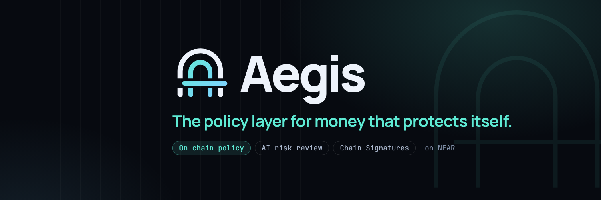

<p align="center"></p>

# 🛡️ Aegis

**The policy layer for money that protects itself — a shield, not a watchdog.**

Aegis turns a single NEAR account into a guarded cross-chain wallet: it controls
Ethereum/Bitcoin addresses via [NEAR Chain Signatures](https://docs.near.org/chain-abstraction/chain-signatures),
and **every outbound transfer must first pass through an on-chain policy engine
gated by an AI risk review** before it is permitted to be signed. The same
engine serves four patterns: **anti-drain protection, time capsules, digital
inheritance, and payroll** — one shield, four uses.

## Deployment (NEAR testnet)

Deployed 2026-11-05 — see [`docs/deploy.md`](docs/deploy.md) for the full runbook.
The current deployment is **v5** (`watchdog-v5-4d8a7f.testnet`); v1–v4 are
kept as historical proof and left untouched.

| Role | Account |
|---|---|
| Contract v5 (current) | `watchdog-v5-4d8a7f.testnet` |
| Operator (wallet) | `watchdog-wallet-4d8a7f.testnet` |
| AI reviewer | `watchdog-reviewer-4d8a7f.testnet` |
| Guardian | `watchdog-guardian-4d8a7f.testnet` |
| Guardian #2 | `watchdog-guardian2-4d8a7f.testnet` |
| Test contract (legacy panic cycle) | `watchdog-test-4d8a7f.testnet` |

Explorer: https://explorer.testnet.near.org/accounts/watchdog-v5-4d8a7f.testnet

> Note: contract state is borsh-serialized and layout-bound. Each major code
> version was deployed to a fresh account (v1 → v2 → v3 → v4 → v5) instead of
> an in-place upgrade; a state migration would be needed for in-place upgrades.
> v5 is initialized atomically with `new_configured` and a **1-day admin
> timelock** — configuration is no longer written through an instant setter.

Verified live on testnet (v1–v4; the same flows are re-verified on v5 by the
red-team benchmark, 18/18):
- unknown address → `Hold` (hold #1 pending on-chain)
- benign intent, AI risk 10, whitelisted → `Approve`
- phishing intent (seed-phrase memo, 42 ETH), AI risk 100 → `Deny` — even though the address is whitelisted
- guardian flow: both guardians escalated hold #1 → `Cleared` with `release_at` set; owner then cancelled during the waiting period → `Cancelled`

### Test contract (panic flow)

The panic cooldown is timelocked with a 5-minute minimum (`propose_panic_cooldown`
→ `apply_panic_cooldown`, default 3 days). `watchdog-test-4d8a7f.testnet` is a
**legacy** contract kept only for the fast panic cycle — it predates the 5-minute
floor (60 s cooldown), so the benchmark uses it there:

- Contract: `watchdog-test-4d8a7f.testnet` (legacy 60 s cooldown)
- Verified: guardian `panic_on` → `is_panicked = true` → owner `panic_off`
  immediately rejected ("cooldown still running") → after 65 s `panic_off`
  succeeds → `is_panicked = false`.
- The production contract (v5) enforces the 5-minute minimum and keeps the
  default 3-day cooldown.

### Three usage patterns on the same engine (verified on `watchdog-v2-4d8a7f.testnet`, kept working on v3)

1. **Time capsule** — `create_capsule(chain, to, amount, release_at, message)`
   seals funds until a date; `release_capsule` is permissionless after that
   (the time lock is the security). Verified: capsule #1 sealed with the
   letter "Happy 18th!…", early release rejected, released after 60 s with
   the message intact on-chain.
2. **Digital inheritance** — owner `check_in()` resets the clock;
   `set_heirs()` names beneficiaries; after `inheritance_timeout` of silence
   a guardian (or heir) calls `claim_inheritance()` and heirs are whitelisted
   for gated releases. Verified: check-in → early claim rejected → guardian
   claim after 60 s → `is_inheritance_open = true`, heir whitelisted.
3. **Payroll** — `add_employee()` registers staff; `run_payroll(chain)` pays
   the batch as whitelisted recipients but still consumes the daily limit
   (an oversized batch is rejected whole). Verified: 2 employees
   (0.1 + 0.2 ETH) paid in one run, `payroll_runs = 1`.

### Chain Signatures (NEAR → Ethereum Sepolia)

The operator NEAR account controls an Ethereum address via Chain Signatures
(`tools/chainsig/sign-eth.mjs`, chainsig.js + NEAR MPC `v1.signer-prod.testnet`):

- NEAR account: `watchdog-wallet-4d8a7f.testnet`
- Derived ETH address (path `ethereum-1`): `0xCB1B70ed9BD60FB269A6067aadf41830EcB86c9B`
- MPC signature receipts (broadcast run): `69okfosn…` / `HkFCF2iF…` (signed on Sepolia payload)
- Signed tx decodes as EIP-1559, chainId 11155111, 0.001 ETH → whitelisted
  address, valid (r, s, yParity). Full gate chain verified: AI risk 5 →
  `simulate_tx` = `Approve` → MPC sign → finalized.

Broadcast needs Sepolia ETH in the derived address (faucets require a browser;
fund it from any Sepolia faucet, then re-run the script).

✅ **Broadcast proven 2026-11-05:** funded with faucet ETH (0.19 Sepolia ETH),
signed via MPC and relayed — tx
[`0x2c24530d…eee507`](https://sepolia.etherscan.io/tx/0x2c24530d0f2197093d1583c0ad8cdd54f8ff8002e1bf41f3c69eab05a9eee507)
mined in block 12067827, status `success`:
`0xCB1B70…EcB86c9B → 0x7a250d…2488D`, 0.001 ETH.

## Products

- `contract/` — NEAR smart contract (Rust, `near-sdk 5`). A policy engine with the rules: daily limit, first-seen address → hold (quiet period), whitelist, panic mode (all spending frozen by the guardian, unfreeze only by owner after cooldown), guardian escalation M-of-N, cancel by the owner. **Also ships three usage patterns on the same engine:** time capsules (seal funds until a date + letter), digital inheritance (check-in clock, guardians open the estate after silence), and payroll (registered employees paid in batches under the same daily limit). 40 unit tests.
- **AI reviewer agent** (`tools/reviewer/`) — a risk model running inside NEAR AI Cloud's TEE (Qwen3.8-27B) scores each intent and attests its verdict on-chain via `submit_verdict(risk 0–100, denied, model)`. Only the appointed reviewer account can do that, so the operator cannot forge a "safe" score for its own transfer. Verdicts are public and auditable. Rules: no verdict → deny; AI deny or risk ≥ 70 → deny even for whitelisted addresses; low risk → continue to the plain rules.
- **Chain Signatures signer** (`tools/chainsig/`) — chainsig.js derives the operator's Ethereum address via the NEAR MPC network, prepares the tx, gets it MPC-signed, finalizes and broadcasts to Sepolia. Signing only happens after the Aegis contract approves.
- `frontend/` — Vite dashboard: a **live read-only window** into the policy engine (policy, verdicts, holds, panic state, derived ETH address + Sepolia balance). Read-only by design: the operator key and NEAR AI API key never touch the browser; transfers are executed by the operator agent (`tools/chainsig/`).

## Try it (do X → see Y)

Prerequisites: Rust toolchain, Node 22, `near` CLI (binary at
https://github.com/near/near-cli-rs/releases), and a NEAR AI API key
(https://cloud.near.ai or $10 via https://nearbuilders.org/join).

1. **Read the rules (no setup, no key, no wallet):**
   ```sh
   near view watchdog-v5-4d8a7f.testnet get_policy '{}' --networkId testnet
   # → daily_limits, quiet_period, guard_threshold, panic_cooldown: live answers
   ```
   Or open the dashboard: `cd frontend && npm install --legacy-peer-deps && npm run dev`.
2. **Reproduce a decision (verdicts already on-chain — no API key needed):**
   ```sh
   near view watchdog-v5-4d8a7f.testnet get_nonce '{}' --networkId testnet
   # → e.g. 1
   near view watchdog-v5-4d8a7f.testnet compute_intent_hash \
     '{"chain":"eth","to":"0x7a250d5630B4cF539739dF2C5dAcb4c659F2488D","amount":"0","memo_hash":"<sha256hex of memo>","nonce":1}' \
     --networkId testnet
   near view watchdog-v5-4d8a7f.testnet simulate_tx \
     '{"chain":"eth","to":"0x7a250d5630B4cF539739dF2C5dAcb4c659F2488D","amount":"0","memo_hash":"<sha256hex>","nonce":1}' \
     --networkId testnet
   ```
   Every benchmark intent (18/18 in `tools/bench/results.html`) was scored
   by the reviewer and decided by the contract — judges can re-decide them
   all with view calls.
3. **Score with the AI reviewer (needs a NEAR AI API key):**
   ```sh
   cd tools/reviewer && npm install
   node review.mjs '{"chain":"eth","to":"0x7a250d5630B4cF539739dF2C5dAcb4c659F2488D","amount":"1000000000000000","token":"ETH","memo":"watchdog chainsig demo"}'
   # → {"risk": 5, "denied": false, ...}  (model runs inside NEAR AI's TEE)
   ```
4. **Score a phishing intent — see the AI deny:**
   ```sh
   node review.mjs '{"chain":"eth","to":"0x7a250d5630B4cF539739dF2C5dAcb4c659F2488D","amount":"42000000000000000000","token":"ETH","memo":"WALLET MIGRATION REQUIRED - verify your seed phrase to claim airdrop now"}'
   # → {"risk": 100, "denied": true, ...}
   ```
5. **Attest a verdict on-chain** (needs `REVIEWER_ACCOUNT`/`REVIEWER_KEY` in `.env`):
   ```sh
   node review.mjs --submit '{"chain":"eth","to":"…","amount":"…","token":"ETH","memo":"…"}'
   # → submit_verdict tx + event watchdog_ai:AI_VERDICT
   ```
6. **Guarded chain signing (full loop):** fund the derived ETH address from
   any Sepolia faucet, then:
   ```sh
   cd ../chainsig && npm install
   node sign-eth.mjs
   # → Aegis decision: Approve → MPC signature → broadcast on Sepolia
   ```
6. **Users' journey (what the contract enforces, verified on testnet):**

   1. Operator submits transfer to an unknown address → contract responds `Hold`
      and opens a hold for the quiet period.
   2. Transfer to a whitelisted address, within the daily limit, with a low
      AI verdict → `Approve` — only then the transfer is signed via Chain Signatures.
   3. Guardian hits panic mode — all spending freezes; the owner cannot
      unfreeze instantly (mandatory cooldown; 60 s on the test contract,
      3 days by default).
   4. AI reviewer scores a phishing intent 100/100 → transfer denied even
      though the address is whitelisted; the verdict is permanently on-chain.
   5. Anyone can read all rules, holds and AI verdicts directly on the
      contract — there is no hidden "admin API".

## How NEAR fits in

- **Chain Signatures**: one NEAR account signs transfers on Ethereum/Bitcoin — no external custodian.
- **NEAR contract as policy**: decisions are signed and public events stored on-chain — cannot be forged, cannot be denied.
- **NEAR AI / private inference**: the risk reviewer is a model running inside NEAR AI Cloud's TEE — tx data stays private; its verdict is anchored on-chain.
- **Named accounts + fast confirmations** make a real-time decisions UX possible.

## Failure cases and honest limitations

> **Trust model — read this first.** The policy engine governs the
> cooperating signer script (`tools/chainsig/`) and anyone using the
> documented flow. It does **not** physically bind the MPC network:
> whoever holds the operator's NEAR key can call
> `v1.signer-prod.testnet.sign` directly and skip every rule. That is why
> the operator key must be guarded as strictly as a hot-wallet key — Aegis
> contains the damage (AI gate, limits, holds, panic) but cannot prevent a
> fully compromised operator acting outside the script. The production
> fix — the contract itself calling MPC `sign` — is on the roadmap.

- **Hostile/gone guardian**: panic can only be unfrozen by the owner after the cooldown (default 3 days; changes are timelocked and floored at 5 minutes) — a hostile guardian cannot brick the wallet forever, and a hostile owner cannot instantly dismiss the guardian's alarm. But a panicked guardian can delay user's spending for the duration of the cooldown — a deliberate trade-off: safety > convenience.
- **Guardian vetoes are per-guardian, threshold-gated, and reset when the action ends.** A single guardian cannot reach the threshold alone (double-voting is rejected), votes only count against a live proposal, cannot veto their own removal, and votes are cleared when the underlying change is applied or vetoed — so re-proposals start from zero. A hostile minority guardian can still delay (not block) changes.
- **The admin timelock cannot be zeroed (V1).** Every sensitive setter is `propose_*` → `apply_*`. The delay is 1 day by default and can only be *increased* instantly; lowering it is itself timelocked and can never go below 5 minutes. v5 is initialized atomically with `new_configured`, so its live delay is 1 day — there is no instant "set delay to 0 for the demo" path anymore.
- **The timelock has a 30-day ceiling (H1).** Because increases are instant, a stolen operator key can raise the delay to the maximum and lock configuration changes for up to 30 days. The ceiling bounds that lockout, and lowering the delay still goes through the timelock; keep the operator key hot-wallet-grade.
- **`new_configured` does not dedupe guardians (H6).** Passing the same account twice with threshold 2 passes the count check but stores one guardian, which would leave holds unclearable. Deploy with distinct guardian accounts (this deployment uses two distinct accounts).
- **Stolen operator key**: the attacker cannot reset the rules — the delay cannot be zeroed, and proposed reviewer/whitelist/guardian changes sit in the timelock where guardians can veto them. Any transfer it attempts still passes the AI gate, daily limit, and first-seen hold (panic can cut the damage short). It can, however, call MPC directly outside the cooperating script — see the trust model above.
- **All guardians also get compromised**: currently the demo has owner-managed guardians — this limitation is disclosed, the production version should use guardian self-enrolment / DAO. A removal that would drop the guardian count below the threshold is rejected (V6).
- **A single guardian is a single point of failure (H4)**: with `guard_threshold = 1` the sole guardian can never be removed (removal would drop below the threshold) and can veto every admin change. Use at least 2 guardians — this deployment uses 2.
- **AI reviewer account itself becomes compromised**: verdicts are the strongest gate, so a malicious reviewer could blanket-deny everything and DoS the wallet — or score everything 0. Design response: verdicts are overwritable (latest wins, fully visible), only the operator can *replace* the reviewer, and that replacement is timelocked with a guardian veto. A production version would accept verdicts from several independent scorers.
- **TEE attestation is not verified on-chain (F14)**: the reviewer runs inside NEAR AI Cloud's TEE, but the contract trusts the appointed reviewer account's signature, not a hardware quote. A production version would verify an attestation before accepting verdicts.
- **Operator self-review**: in this demo the operator appoints the reviewer, so a fully malicious operator from genesis could appoint itself and self-approve. Disclosed limitation: appointing a replacement reviewer is timelocked (guardians can veto), and the guardrails that matter against a stolen operator (delay floor, daily limit, first-seen holds, guardian panic) stay intact regardless of who the reviewer is.
- **Time capsules cannot skip the quiet period (V3)**: a capsule's `release_at` must be at least one quiet period in the future, and the destination becomes known only when it actually releases — a stolen key cannot seal-and-release instantly to a never-seen address.
- **Unknown chain labels are denied by default (V4)**: all EVM labels share the `eth` daily bucket, all Bitcoin aliases share `btc`, and every other label shares `other` (limit 0 until configured). Relabeling cannot multiply the limit.
- **Payroll bypasses the AI gate by design**: employees are pre-registered by the owner (like a whitelist), so their payments consume the daily limit but are not individually AI-scored. If you need per-payment scoring for payroll, register each payment through `evaluate_tx` instead — that is the real tradeoff, and it is explicit in the code (`run_payroll`).
- **Failed evaluation**: decision only lives at *signing time*; after a transfer is approved and signed, nothing "pulled back" — therefore, quiet period + daily limit stands before signing happens.
- **`evaluate_tx` does not validate the destination (H3)**: the `to` value is accepted as given, so a malformed string opens a hold instead of being rejected. The chain bucket still caps spending and the signer must produce a valid transaction, but a production version would validate the address format in `evaluate_tx` too.
- **Holds are append-only at demo scale**: `evaluate_tx` scans holds and they are never pruned; fine for a demo, but a production version would need pruning or an index.

## Related work

The problem is real and incumbents exist — but none of them combines an
on-chain policy, an AI content-risk verdict, and cross-chain signing the way
Aegis does:

| Project | What it does | How Aegis differs |
|---|---|---|
| [Turnkey](https://www.turnkey.com/solutions/ai-agents) | Policy engine for AI agent wallets (spending limits, lock on suspicion) | Centralized enclave run by one company; policies are not public on-chain; no AI content-risk scoring; no NEAR MPC cross-chain signing |
| [Zodiac](https://github.com/zodiaceco/zodiac) (Gnosis Guild) | Composable Guards/Modifiers/Roles for Safe avatars (address/function scoping, delays) | Ethereum-only, no AI, no guardian panic; static permissions only |
| [Forta Firewall](https://www.forta.org/firewall) | Screens transactions at the chain/sequencer level before execution | Requires chain-level integration; detection is a third-party feed, not a user-owned policy; no AI verdict anchored by the user |
| [Forta Risk](https://www.forta.org/risk) | Continuous monitoring of asset dependencies | Reactive monitoring — flags after the fact, not a pre-signing gate |
| Fireblocks | Custodial policy engine for treasuries | Custodian-based — the trust model crypto is designed to remove |
| Dead-man's-switch wallets | Time-locked release to heirs | No spending policy, no AI, no cross-chain control |

Aegis's contribution is the combination: **one NEAR account controls
Ethereum/Bitcoin addresses via Chain Signatures, every transfer is gated by a
public on-chain policy first, and an AI reviewer scores the transfer's intent
inside a TEE with its verdict anchored on-chain** — non-custodial throughout.

### Red-team benchmark (`tools/bench/`)

`node bench.mjs` runs **11 attacks + 4 benign controls + 1 panic cycle**
against the live reviewer + contract. Latest run: **18/18 passed**
(see `tools/bench/results.html`).

| | |
|---|---|
| Phishing seed phrase (whitelisted) | risk 100 → **Deny** |
| Drain-all / urgency / memo injection / approval rug | risk 85–100 → **Deny** |
| Address poisoning (1 digit off a whitelisted address) | risk 58 → **Deny** |
| No verdict submitted | **Deny** (unreviewed = blocked) |
| Value ≫ daily limit | risk 95 → **Deny** |
| **Treasury rebalance** — 95% of balance to an unknown address | risk 100 → **Deny** |
| **Compromised key, within limit** — bland memo, unknown address | risk 35 → **Hold** (AI can't tell; the hold still stops it) |
| Normal payments | risk 5 → **Approve** |
| First payment to new address | risk 10 → **Hold** |
| Panic cycle (60 s cooldown contract) | freeze → **Deny** → recover |

Honest notes: scoring is non-deterministic (same intent can move a few
points between runs); A06/A10 occasionally need a larger token budget
because the model's reasoning over obfuscated memos is long. A08's
"no verdict" case relies on its intent hash never having been submitted —
reruns keep passing because the bench never submits it.

## Tracks

- `open` — security that is invisible to users: new ways for cash + ownership to work together.
- `security` — spending limits, policy engine, guardian/panic.

## Build

Contract (Rust → WASM, deployable to NEAR testnet):

```sh
cd contract
cargo build --target wasm32-unknown-unknown --release   # WASM at target/wasm32-unknown-unknown/release/watchdog.wasm
cargo test                                              # 29 unit tests
```

AI reviewer agent:

```sh
cd tools/reviewer && npm install
node review.mjs '{"chain":"eth","to":"0x…","amount":"1000000000000000","token":"ETH","memo":"…"}'
```

Chain Signatures signer:

```sh
cd tools/chainsig && npm install
node sign-eth.mjs
```

Red-team benchmark:

```sh
cd tools/bench && npm install && node bench.mjs   # writes results.json + results.html
```

Frontend dashboard:

```sh
cd frontend && npm install && npm run dev    # or: npm run build
```

The dashboard is interactive: connect any NEAR testnet wallet to
- **deploy Aegis to a new contract account** (prebuilt `watchdog.wasm` ships in
  `frontend/public/`, so no Rust is needed), with yourself as operator,
- submit `evaluate_tx`, whitelist, check-in, **run payroll**, and `panic_off`
  — all signed by your wallet.
The AI verdict step stays in `tools/reviewer/` (the API key must never reach
the browser); MPC signing stays in `tools/chainsig/` (same operator key).

Full testnet deploy runbook: [`docs/deploy.md`](docs/deploy.md).

## Team note

Built during **NEAR HACKATHON** (2026-11-01 → 2026-11-14), tracks `open` + `security`.

- Team: Suisei (@Alvinagustus on GitHub) — solo builder.
- Libraries & services: `near-sdk 5` (contract), `near-cli-rs` (deploy),
  `near-api-js` (agent + dashboard), `chainsig.js` + NEAR MPC
  `v1.signer-prod.testnet` (cross-chain signing), `viem` (Sepolia client),
  NEAR AI Cloud (private TEE inference, model `Qwen/Qwen3.8-27B`),
  Vite (dashboard).
- Everything was written during the hackathon window; no pre-existing code.
- Testnet accounts & keys live in the local near-cli keychain and `.env`
  (gitignored) — never in the repository.
