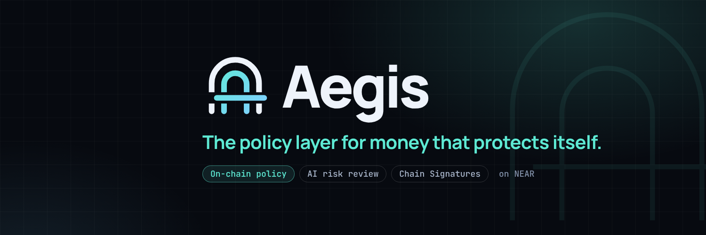

<p align="center"></p>

# Aegis

**The policy layer for money that protects itself — a shield for cross-chain spending.**

Aegis turns a NEAR account into a guarded cross-chain wallet: it controls
Ethereum/Bitcoin addresses via [NEAR Chain Signatures](https://docs.near.org/chain-abstraction/chain-signatures),
and **every outbound transfer is evaluated against an on-chain policy engine
gated by an AI risk review**. On approval, the contract performs contract-bound
MPC signing (XCC) so signing authority is tied to policy — not an off-chain signer.

The same engine serves four patterns: **anti-drain protection, time capsules,
digital inheritance, and payroll**.

**Live dashboard:** https://aegispolicy.vercel.app

## Deployment (NEAR testnet)

| Role | Account |
|---|---|
| Contract | `aegis.testnet` |
| Operator | `aegis-operator.testnet` |
| AI reviewer | `aegis-reviewer.testnet` |
| Guardian | `aegis-guardian.testnet` |
| Guardian #2 | `aegis-guardian2.testnet` |

- Contract-bound MPC: `evaluate_and_sign` binds unsigned EIP-1559 `to`/`value` (RLP) to the evaluated intent, enforces policy/verdict gates, and on `Approve` invokes the MPC signer via XCC (`v1.signer-prod.testnet`); `on_sign_callback` refunds `daily_spent` on MPC failure.
- Initialized atomically with `new_configured(..., mpc_contract)` and a **1-day admin timelock** (threshold 2).
- Explorer: https://explorer.testnet.near.org/accounts/aegis.testnet
- Full runbook: [`docs/deploy.md`](docs/deploy.md)

> State is borsh/layout-bound; deploy major changes to fresh accounts (no in-place state-layout migration).

## Products

- `contract/` — NEAR smart contract (Rust, `near-sdk 5`). Policy engine (daily limits, first-seen hold/quiet period, whitelist, guardian panic + cooldown, M-of-N escalation, timelocked admin) plus time capsules, inheritance, and payroll. `evaluate_and_sign` (contract-bound MPC XCC) and `on_sign_callback` (refund on failure); `evaluate_tx`/`simulate_tx` kept for compatibility/read-only use. **47 unit tests.**
- `tools/reviewer/` — AI risk reviewer (NEAR AI Cloud TEE) attests verdicts on-chain via `submit_verdict` (risk 0–100, denied). Only the appointed reviewer may submit; verdicts are auditable.
- `tools/chainsig/` — Untrusted relayer: derives the **contract-bound** ETH address, builds unsigned EIP-1559 RLP, calls `evaluate_and_sign` (300 TGas + MPC deposit), assembles MPC signature, and broadcasts.
- `frontend/` — Vite dashboard: instant simulated demo and read-only view of the live on-chain contract (no wallet connect in main UI). Keys never reach the browser.

## Try it

### Web demo (no wallet, read-only)
Open **https://aegispolicy.vercel.app**:
- **Instant simulated demo** — explore policy behavior locally in your browser.
- **Live on-chain demo (read-only)** — inspect real contract state on testnet (`aegis.testnet`).

All demo interactions in the web UI are simulated/read-only (no on-chain writes).

### Build & test

```sh
cd contract
cargo build --target wasm32-unknown-unknown --release   # target/wasm32-unknown-unknown/release/aegis.wasm
cargo test                                              # 47 tests
```

### Deploy your own instance (CLI)

```sh
./setup.sh <operator.testnet> <contract.testnet> [reviewer] [guardian] [threshold]
# or follow docs/deploy.md for contract-bound MPC deployment
```

### AI verdict + contract-bound signing

```sh
# 1) Review & attest verdict (set NEAR_AI_API_KEY, REVIEWER_* in .env)
cd tools/reviewer && npm install
AEGIS_CONTRACT=aegis.testnet node review.mjs --submit \
  '{"chain":"eth","to":"0x7a250d5630B4cF539739dF2C5dAcb4c659F2488D","amount":"1000000000000000","token":"ETH","memo":"payment"}'

# 2) Contract-bound signing (fund contract-derived ETH address on Sepolia first)
cd ../chainsig && npm install
AEGIS_CONTRACT=aegis.testnet CALLER_ACCOUNT=aegis-operator.testnet \
  node sign-eth.mjs 0x7a250d5630B4cF539739dF2C5dAcb4c659F2488D 0.001 "payment"
# → unsigned tx → evaluate_and_sign (policy + RLP binding + MPC XCC)
# → Approve: signature + broadcast | Hold/Deny: no signature
```

## How NEAR fits in

- **Chain Signatures (MPC)**: contract-bound derivation/path and XCC signing authorization on approval.
- **On-chain policy**: decisions, verdicts, and events are auditable on-chain; relayers are untrusted.
- **NEAR AI (TEE)**: intent risk scored in NEAR AI Cloud; verdict attested on-chain.
- **Named accounts + fast finality** for responsive policy UX.

## Trust model & limitations

- `evaluate_and_sign` binds EIP-1559 `to`/`value` from `raw_tx_rlp`, runs the same gates as `evaluate_tx`, and signs via MPC XCC on `Approve`; `on_sign_callback` refunds `daily_spent` on MPC failure. Relayers cannot obtain a valid signature without an approving on-chain call.
- A compromised **operator** can still submit policy-passing intents (damage bounded by limits/holds/verdicts/panic/timelocks). MPC service/key-path and TEE attestation are trust assumptions (not fully enforced on-chain).
- **Timelocks:** sensitive changes are `propose_*` → `apply_*` (1-day default, min 5 min, max 30 days); guardians can veto. Cooldowns/thresholds constrain panic and escalation.
- **AI gate:** no/missing/expired/high-risk verdict → deny (by policy). TEE attestation not verified on-chain; reviewer compromise/DoS and operator-reviewer collusion at genesis are disclosed risks.
- **Guardians:** M-of-N; hostile minority can delay, not permanently brick (owner unfreeze after cooldown). Misconfiguration (e.g. threshold issues via unsafe bootstrap) is mitigated by `new_configured`.
- **Usage semantics:** first-seen → hold (quiet period); unknown chain labels share restricted buckets; payroll bypasses per-payment AI by design; `simulate_tx` is a dry-run view (may diverge from `evaluate_tx` side effects/preapprovals). See contract comments for full edge-case notes.

## Build

```sh
cd contract && cargo test && cargo build --target wasm32-unknown-unknown --release
cd frontend && npm install --legacy-peer-deps && npm run build
```

## Team

Built during **NEAR HACKATHON** (2026-11-01 → 2026-11-14), tracks `open` + `security`.
Solo builder: Suisei ([@Alvinagustus](https://github.com/Alvinagustus)).
Stack: `near-sdk 5`, `near-cli-rs`, `near-api-js`, `chainsig.js` + NEAR MPC, `viem`, NEAR AI Cloud, Vite.
Testnet accounts/keys live locally (`.env`, keychain) — gitignored.
